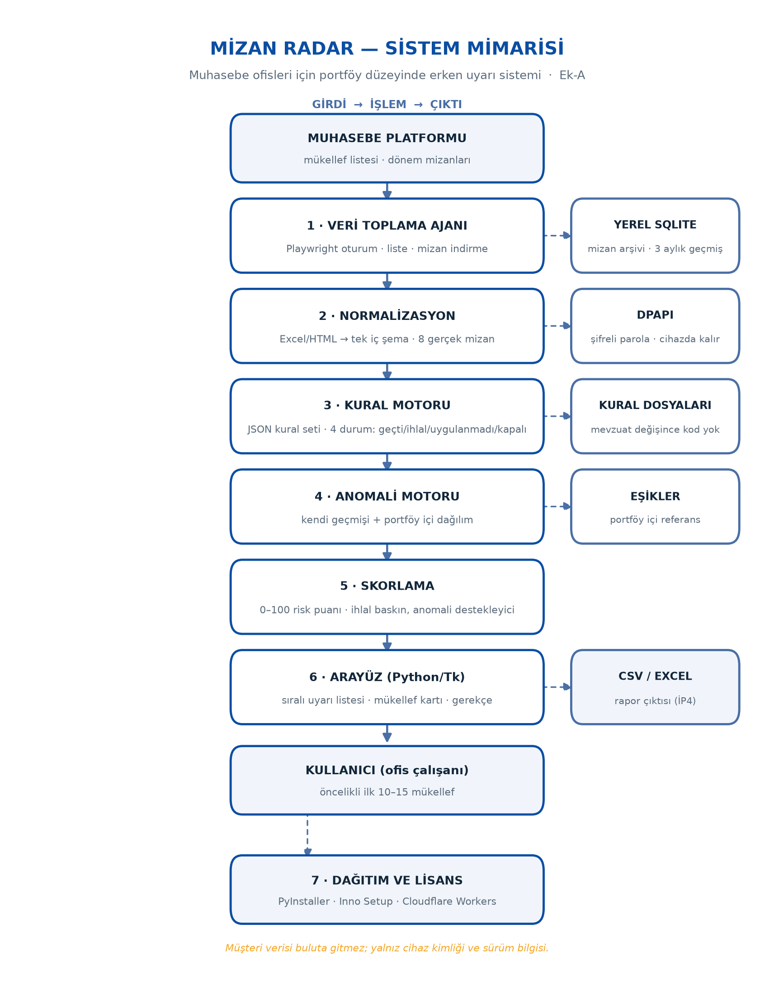

# Mizan Radar

**Muhasebe ofisleri için portföy düzeyinde erken uyarı sistemi.**

Bir muhasebe ofisi ay sonunda 150–300 mükellefin mizanını tek tek açıp kontrol eder.
Uzman bir çalışan mükellef başına ortalama **12 dakika** harcar; 200 mükelleflik bir
portföyde bu **ayda ~40 saat** eder. Mizan Radar bu taramayı tek tuşa indirir ve
"bu ay hangi mükellefe bakmalısın" sorusunu öncelik sıralı bir listeyle yanıtlar.

Her uyarı hesap kodu, tutar, eşik ve önceki dönem değeriyle gerekçelendirilir —
kara kutu skor değil, denetlenebilir gerekçe.

## Ne yapar

1. **Toplar** — ofisin portal oturumuyla mükellef listesini ve mizanları indirir
   (mükellef başına ~3–4 sn).
2. **Normalize eder** — Excel/HTML mizanları tek iç şemaya çevirir.
3. **Denetler** — kural motoru (12 tanımlı kural) + anomali motoru
   (mükellefin kendi geçmişi ve portföy içi dağılım).
4. **Puanlar** — 0–100 risk puanı, öncelik sıralı liste.
5. **Gerekçelendirir** — hesap kodu, tutar, eşik, önceki dönem karşılaştırması.

Kullanıcı ofis çalışanıdır, ödeyen ofis sahibidir (SMMM).

## Mimari

| # | Bileşen | Görev |
|---|---------|-------|
| 1 | Veri toplama ajanı | Playwright; oturum, mükellef listesi, mizan indirme |
| 2 | Normalizasyon | Excel/HTML → tek iç şema |
| 3 | Kural motoru | JSON kural seti, 4 durum (geçti / ihlal / uygulanmadı / kapalı) |
| 4 | Anomali motoru | Kendi geçmişi (hareketli ortalama, standart sapma) + portföy içi dağılım |
| 5 | Skorlama | 0–100 risk puanı |
| 6 | Arayüz | Sıralı uyarı listesi ve mükellef kartı |
| 7 | Dağıtım | PyInstaller + Inno Setup + lisans/güncelleme katmanı (mükellef verisi cihazdan çıkmaz) |

## Ölçümler (gerçek)

| Ölçüm | Sonuç |
|---|---|
| Portföy büyüklüğü | 297 mükellef |
| Oturum açma | ~11 sn |
| Mükellef listesi | ~4 sn |
| Mizan indirme | 3–4 sn / mükellef |
| Normalizasyon testi | 8 gerçek mizan, 75–201 satır |
| Ardışık oturum testi | 20 oturum, platform korumasına takılmadı |
| Tanımlı kural | 12 (hedef: 20 proje sonunda, 40 üçüncü yılda) |
| Elle denetim | ~12 dk / mükellef → 200 mükellefte ~40 saat/ay |

## Durum

Bileşenlerin olgunluğu farklıdır ve burada olduğu gibi etiketlenmiştir.

| Durum | Bileşenler |
|---|---|
| Çalışıyor | Veri toplama, normalizasyon, kural motoru, dağıtım altyapısı |
| Prototip | Anomali skorlama ve pano (ağırlık kalibrasyonu henüz yok) |
| Planlı | 3 aylık geçmiş + "incelendi/görmezden gel" hafızası, Excel raporu, pilot saha ölçümü |

Ticari ürünün çalışan bileşenleri kapalı kaynak olarak geliştirilmektedir. Bu depo mimariyi,
ölçümleri ve yol haritasını yayınlar.

## Neden bu ofisler

Mizan verisi zaten ofisin elinde; sorun verinin yokluğu değil, **hacmi**. 300 mükellefin
mizanını insan gözüyle taramak mümkün olmadığı için hatalar genelde beyanname verildikten ve
düzeltme süresi geçtikten sonra fark edilir. Erken uyarı, hata hâlâ düzeltilebilirken
uyarmak demektir.

## Yol haritası

- **0–3 ay** — kural setini 20'ye çıkarmak, pilot ofiste 3 aylık geçmişle geriye dönük test
- **3–9 ay** — "incelendi / görmezden gel" hafızası, Excel raporu, hata kaçırma oranı ölçümü
- **9–24 ay** — çok kullanıcılı ofis lisansı, KDV çapraz kontrol modülüyle entegrasyon
- **24 ay+** — e-Beyanname ve e-Defter verisiyle genişletme

## Lisans

Bu depodaki dokümantasyon ve şema **CC BY-NC 4.0** ile paylaşılır. Ürün adı ve markası saklıdır.
